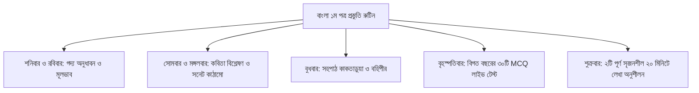

# এসএসসি বাংলা ১ম পত্র সকল বোর্ড প্রশ্ন ও সমাধান ২০২৬: সৃজনশীল (CQ) ও নৈর্ব্যক্তিক (MCQ) পূর্ণাঙ্গ বিশ্লেষণ

এসএসসি পরীক্ষার প্রথম দিনটি শুরু হয় বাংলা ১ম পত্র পরীক্ষার মাধ্যমে। তাই প্রথম পরীক্ষাটি ভালো হওয়া প্রতিটি শিক্ষার্থীর মানসিক আত্মবিশ্বাস তুঙ্গে রাখার জন্য অত্যন্ত জরুরি। গদ্য, পদ্য, সহপাঠ (উপন্যাস ও নাটক)—সব মিলিয়ে সুবিশাল সিলেবাস থেকে সৃজনশীল প্রশ্নের মূলভাব ফুটিয়ে তোলা এবং ৩০টি বহুনির্বাচনি প্রশ্নের নির্ভুল উত্তর দেওয়া পরীক্ষায় কাঙ্ক্ষিত এ প্লাস (A+) অর্জনের প্রধান মাপকাঠি।

তুমি যদি ২০২৬ সালের এসএসসি বাংলা ১ম পত্র পরীক্ষার উত্তর মিলিয়ে দেখতে চাও কিংবা ২০২৭ সালের পরীক্ষার্থী হিসেবে পূর্ববর্তী বছরের প্রশ্নপত্রের ধরণ পর্যালোচনা করে নিখুঁত প্রস্তুতি নিতে চাও, তবে এই বিশ্লেষণটি তোমাকে পরিপূর্ণ দিকনির্দেশনা দেবে।

> [!NOTE]
> **এক নজরে এসএসসি বাংলা ১ম পত্র ২০২৬**
> - **মোট পূর্ণমান:** ১০০ নম্বর (সৃজনশীল ৭০ + বহুনির্বাচনি ৩০)।
> - **সৃজনশীল অংশ:** ১১টি প্রশ্ন থেকে ৭টির উত্তর দিতে হয় (ক-বিভাগ গদ্য থেকে ২টি, খ-বিভাগ কবিতা থেকে ২টি, গ-বিভাগ উপন্যাস থেকে ১টি, ঘ-বিভাগ নাটক থেকে ১টি এবং যেকোনো বিভাগ থেকে আরও ১টি)।
> - **বহুনির্বাচনি অংশ:** ৩০টি প্রশ্ন, প্রতিটি ১ নম্বর (সময় ৩০ মিনিট)।
> - **উৎস ও ভিত্তি:** জাতীয় শিক্ষাক্রম ও পাঠ্যপুস্তক বোর্ড (NCTB) অনুমোদিত পাঠ্যবই এবং ৯টি সাধারণ শিক্ষা বোর্ডের অফিশিয়াল প্রশ্ন কাঠামো।

> [!WARNING]
> **ডিসক্লেইমার ও তথ্যসূত্র:**
> এই নিবন্ধের বহুনির্বাচনি উত্তরমালা ও সৃজনশীল ব্যাখ্যা অভ্যাস শিক্ষক প্যানেল ও বিষয়ভিত্তিক শিক্ষকদের পর্যালোচনায় NCTB পাঠ্যবই অনুযায়ী তৈরি। বোর্ড চ্যালেঞ্জ বা অফিশিয়াল মূল্যায়নে স্ব স্ব শিক্ষা বোর্ডের নির্ধারিত উত্তরপত্রই চূড়ান্ত বলে গণ্য হবে।

---

## সূচিপত্র (Table of Contents)
- [১. প্রশ্ন কাঠামো ও বিভাগভিত্তিক মানবণ্টন](#১-প্রশ্ন-কাঠামো-ও-বিভাগভিত্তিক-মানবণ্টন)
- [২. ৯টি সাধারণ শিক্ষা বোর্ডের MCQ উত্তরমালা (ক-সেট)](#২-৯টি-সাধারণ-শিক্ষা-বোর্ডের-mcq-উত্তরমালা-ক-সেট)
- [৩. বোর্ডভিত্তিক সৃজনশীল (CQ) উদ্দীপক ও প্রশ্নের রূপরেখা](#৩-বোর্ডভিত্তিক-সৃজনশীল-cq-উদ্দীপক-ও-প্রশ্নের-রূপরেখা)
- [৪. একটি পূর্ণাঙ্গ আদর্শ সৃজনশীল সমাধান: 'সুভা' (ক, খ, গ, ঘ)](#৪-একটি-পূর্ণাঙ্গ-আদর্শ-সৃজনশীল-সমাধান-সুভা-ক-খ-গ-ঘ)
- [৫. বিগত ৫ বছরের প্রশ্ন বিশ্লেষণ ও রচনাভিত্তিক গুরুত্ব ছক](#৫-বিগত-৫-বছরের-প্রশ্ন-বিশ্লেষণ-ও-রচনাভিত্তিক-গুরুত্ব-ছক)
- [৬. প্রতিটি রচনার মোস্ট রিপিটেড MCQ হটস্পট পয়েন্ট](#৬-প্রতিটি-রচনার-মোস্ট-রিপিটেড-mcq-হটস্পট-পয়েন্ট)
- [৭. ২০২৭ পরীক্ষার্থীদের জন্য সেরা প্রস্তুতি রুটিন ও কর্মপরিকল্পনা](#৭-২০২৭-পরীক্ষার্থীদের-জন্য-সেরা-প্রস্তুতি-রুটিন-ও-কর্মপরিকল্পনা)
- [৮. বাংলা ১ম পত্রে যে ৫টি কারণে নম্বর কাটা যায়](#৮-বাংলা-১ম-পত্রে-যে-৫টি-কারণে-নম্বর-কাটা-যায়)
- [৯. সচরাচর জিজ্ঞাসা (FAQ)](#সচরাচর-জিজ্ঞাসা-faq)
- [১০. পরবর্তী বিষয়ের প্রস্তুতি ও সহায়ক রিসোর্স](#১০-পরবর্তী-বিষয়ের-প্রস্তুতি-ও-সহায়ক-রিসোর্স)

---

## ১. প্রশ্ন কাঠামো ও বিভাগভিত্তিক মানবণ্টন

বাংলা ১ম পত্রে ভালো ফলাফলের মূল চাবিকাঠি হলো বিভাগভিত্তিক প্রশ্নের সঠিক বণ্টন বজায় রেখে উত্তর লেখা। ভুল বিভাগে অতিরিক্ত উত্তর লিখলে তা মূল্যায়নে বাতিল হয়ে যাবে:

| বিভাগ | উৎস | মোট প্রশ্ন | বাধ্যতামূলক উত্তর | মোট বরাদ্দ নম্বর |
| :--- | :--- | :---: | :---: | :---: |
| **ক-বিভাগ** | গদ্য (*সাহিত্য সংকলন*) | ৪টি | ন্যূনতম ২টি | ২০ |
| **খ-বিভাগ** | কবিতা (*সাহিত্য সংকলন*) | ৩টি | ন্যূনতম ২টি | ২০ |
| **গ-বিভাগ** | উপন্যাস (*কাকতাড়ুয়া*) | ২টি | ন্যূনতম ১টি | ১০ |
| **ঘ-বিভাগ** | নাটক (*বহিপীর*) | ২টি | ন্যূনতম ১টি | ১০ |
| **অতিরিক্ত** | যেকোনো বিভাগ (ক, খ, গ, বা ঘ) | — | যেকোনো ১টি | ১০ |
| **সৃজনশীল মোট** | সমগ্র পাঠ্যবই | **১১টি** | **৭টি** | **৭০** |
| **বহুনির্বাচনি (MCQ)** | সমগ্র পাঠ্যবই | **৩০টি** | **৩০টি** | **৩০** |
| **সর্বমোট** | | | | **১০০** |

---

## ২. ৯টি সাধারণ শিক্ষা বোর্ডের MCQ উত্তরমালা (ক-সেট)

২০২৬ সালের বাংলা ১ম পত্র পরীক্ষায় ৯টি সাধারণ শিক্ষা বোর্ডে (ঢাকা, রাজশাহী, কুমিল্লা, যশোর, চট্টগ্রাম, বরিশাল, সিলেট, দিনাজপুর ও ময়মনসিংহ) প্রশ্নপত্রে চার সেট কোড (ক, খ, গ, ঘ) ব্যবহৃত হয়েছে। নিচে বহুল প্রচলিত **'ক' সেট**-এর সমাধান দেওয়া হলো (অন্যান্য সেটের ক্ষেত্রে প্রশ্ন নম্বর অদল-বদল থাকবে):

| প্রশ্ন নং | ঢাকা বোর্ড | রাজশাহী বোর্ড | কুমিল্লা বোর্ড | যশোর বোর্ড | চট্টগ্রাম বোর্ড | বরিশাল বোর্ড | সিলেট বোর্ড | দিনাজপুর বোর্ড | ময়মনসিংহ বোর্ড |
| :---: | :---: | :---: | :---: | :---: | :---: | :---: | :---: | :---: | :---: |
| **০১** | গ | খ | ক | গ | ঘ | খ | গ | ক | খ |
| **০২** | খ | গ | ঘ | খ | ক | গ | খ | ঘ | ক |
| **০৩** | খ | ক | খ | খ | খ | ক | খ | গ | গ |
| **০৪** | ক | ঘ | গ | ক | গ | ঘ | ক | খ | ঘ |
| **০৫** | ঘ | খ | খ | ঘ | খ | খ | ঘ | ক | খ |
| **০৬** | গ | ক | ক | গ | ক | ক | গ | খ | ক |
| **০৭** | খ | গ | ঘ | খ | গ | গ | খ | ঘ | গ |
| **০৮** | ক | খ | খ | ক | খ | খ | ক | ক | খ |
| **০৯** | ঘ | ঘ | গ | ঘ | ঘ | ঘ | ঘ | গ | ঘ |
| **১০** | গ | খ | ক | গ | খ | খ | গ | খ | খ |
| **১১** | খ | ক | ঘ | খ | ক | ক | খ | ঘ | ক |
| **১২** | ক | গ | খ | ক | গ | গ | ক | ক | গ |
| **১৩** | ঘ | খ | ক | ঘ | খ | খ | ঘ | গ | খ |
| **১৪** | গ | ঘ | ঘ | গ | ঘ | ঘ | গ | খ | ঘ |
| **১৫** | খ | ক | খ | খ | ক | ক | খ | ক | ক |
| **১৬** | ক | খ | গ | ক | খ | খ | ক | ঘ | খ |
| **১৭** | ঘ | গ | ক | ঘ | গ | গ | ঘ | খ | গ |
| **১৮** | খ | ক | ঘ | খ | ক | ক | খ | ক | ক |
| **১৯** | গ | ঘ | খ | গ | ঘ | ঘ | গ | গ | ঘ |
| **২০** | ক | খ | গ | ক | খ | খ | ক | খ | খ |
| **২১** | ঘ | ক | ক | ঘ | ক | ক | ঘ | ঘ | ক |
| **২২** | খ | গ | ঘ | খ | গ | গ | খ | ক | গ |
| **২৩** | গ | খ | খ | গ | খ | খ | গ | খ | খ |
| **২৪** | ক | ঘ | ক | ক | ঘ | ঘ | ক | গ | ঘ |
| **২৫** | ঘ | ক | গ | ঘ | ক | ক | ঘ | খ | ক |
| **২৬** | খ | খ | খ | খ | খ | খ | খ | ঘ | খ |
| **২৭** | গ | গ | ক | গ | গ | গ | গ | ক | গ |
| **২৮** | ক | ঘ | ঘ | ক | ঘ | ঘ | ক | খ | ঘ |
| **২৯** | খ | ক | খ | খ | ক | ক | খ | গ | ক |
| **৩০** | ঘ | খ | গ | ঘ | খ | খ | ঘ | ঘ | খ |

> [!TIP]
> **তোমার সেটের উত্তর দ্রুত মেলাবে কীভাবে?**
> প্রশ্নপত্রের সেট আলাদা হলেও প্রশ্নগুলো একই থাকে, শুধু ক্রম পরিবর্তন করা হয়। তাই প্রশ্নের মূল শব্দ বা বাক্যটি লক্ষ্য করে উপরোক্ত তালিকার সাথে মিলিয়ে নাও।

---

> ### 📱 এই প্রশ্নগুলো কি অ্যাপে টেস্ট দিতে চাও?
> বিগত ৫ বছরের সকল বোর্ড প্রশ্ন এবং অধ্যায়ভিত্তিক গুরুত্বপূর্ণ MCQ এখন টাইমারসহ প্র্যাকটিস করা যায় অভ্যাসে। সাথে সাথেই ভুল উত্তরের সঠিক ব্যাখ্যা পেয়ে যাবে।
> 
> 👉 **[অভ্যাস অ্যাপে বাংলা ১ম পত্র লাইভ টেস্ট দাও](https://play.google.com/store/apps/details?id=com.obhyash.app)** অথবা ব্রাউজারে প্র্যাকটিস করতে ভিজিট করো [obhyash.com](https://obhyash.com)।

---

## ৩. board-ভিত্তিক সৃজনশীল (CQ) উদ্দীপক ও প্রশ্নের রূপরেখা

বিভিন্ন শিক্ষা বোর্ডে আসা সৃজনশীল প্রশ্নগুলোর উদ্দীপক ও প্রাসঙ্গিক রচনার উৎস নিচে সংক্ষেপে তুলে ধরা হলো:

1. **ঢাকা বোর্ড:**
   - *গদ্য:* 'সুভা' (প্রতিবন্ধী মেয়ের প্রতি প্রকৃতির মমত্ববোধ) এবং 'বই পড়া' (অনর্থক মুখস্থ বিদ্যার অপকারিতা)।
   - *পদ্য:* 'মানুষ' (ধর্মীয় গোঁড়ামি ও ভণ্ডামি) এবং 'কপোতাক্ষ নদ' (প্রবাসে জন্মভূমির স্মৃতি)।
   - *সহপাঠ:* 'কাকতাড়ুয়া' (বুধার পাকিস্তানি ক্যাম্প ধ্বংসের কৌশল) ও 'বহিপীর' (তাহেরার আত্মমর্যাদাবোধ ও পলায়ন)।
2. **রাজশাহী বোর্ড:**
   - *গদ্য:* 'একাত্তরের দিনগুলি' (রুমি ও ক্র্যাক প্লাটুনের আত্মত্যাগ) ও 'আম-আঁটির ভেঁপু' (গ্রামীণ শৈশবের আনন্দ-বেদনা)।
   - *পদ্য:* 'পল্লীজননী' (রোগাক্রান্ত সন্তানের শিয়রে দরিদ্র মায়ের কান্না) ও 'রানার' (শ্রমজীবী মানুষের দায়বদ্ধতা)।
   - *সহপাঠ:* 'কাকতাড়ুয়া' (আহাদ মুন্সীর বিশ্বাসঘাতকতা) ও 'বহিপীর' (হাশেম আলীর আধুনিক মানসিকতা)।
3. **কুমিল্লা ও চট্টগ্রাম বোর্ড:**
   - *গদ্য:* 'মানুষ মুহম্মদ (স.)' (নেতার ক্ষমার মহত্ত্ব) ও 'নিমগাছ' (গৃহিণীর অপ্রকাশিত অবদানের রূপক)।
   - *পদ্য:* 'তোমাকে পাওয়ার জন্যে, হে স্বাধীনতা' ও 'আমার পরিচয়' (বাঙালির হাজার বছরের ইতিহাস)।
   - *সহপাঠ:* 'কাকতাড়ুয়া' ও 'বহিপীর'-এর নাট্যদ্বন্দ্ব।

---

## ৪. একটি পূর্ণাঙ্গ আদর্শ সৃজনশীল সমাধান: 'সুভা' (ক, খ, গ, ঘ)

বোর্ডে পূর্ণ ১০ নম্বর পাওয়ার জন্য ৪ স্তরের আদর্শ সৃজনশীল কীভাবে সাজাতে হয়, তা রবীন্দ্রনাথ ঠাকুরের কালজয়ী ছোটগল্প **'সুভা'**-র একটি উদ্দীপক ও উত্তরের মাধ্যমে দেখানো হলো:

### উদ্দীপক:
> দশ বছরের বাক্‌প্রতিবন্ধী মেয়ে নদী কথা বলতে পারে না। মা তাকে পরিবারের একটি বোঝা বলে মনে করে সারাক্ষণ কটু কথা শোনায়। কিন্তু বাবা করিম মাঝি নদীকে প্রাণের চেয়ে বেশি ভালোবাসেন। নদীর নিঃশব্দ চোখের ভাষা একমাত্র বোঝে বাড়ির পোষা বেড়ালছানাটি ও উঠোনের শিউলি গাছটি। নদী গাছটির নিচে বসে ঘণ্টার পর ঘণ্টা নিজের অব্যক্ত বেদনা প্রকাশ করে।

---

### প্রশ্ন ও আদর্শ উত্তরমালা:

#### (ক) সুভার পুরো নাম কী? (মান: ১)
**উত্তর:** সুভার পুরো নাম সুভাষিণী।

---

#### (খ) "প্রকৃতি যেন তাহার ভাষার অভাব পূরণ করিয়া দেয়"—কথাটির অর্থ বুঝিয়ে লেখো। (মান: ২)
**উত্তর:** কথাটি দ্বারা মূক বালিকা সুভার সাথে মূক প্রকৃতির আত্মিক ও নিঃশব্দ বন্ধুত্বের গভীর সম্পর্ককে বোঝানো হয়েছে।

সুভা বাক্‌প্রতিবন্ধী হওয়ায় মানুষের সমাজে তার অনুভূতি প্রকাশের কোনো ভাষা ছিল না। কিন্তু ঝিঁঝির ডাক, নদীর কলতান, পাতাঝরার শব্দ আর বাতাসের মর্মরধ্বনি—প্রকৃতির এই বিচিত্র রূপ ও শব্দ সুভার অন্তরের অব্যক্ত ভাবনার সাথে একাত্ম হয়ে যেত। মানুষ সুভাকে অবহেলা করলেও উদার প্রকৃতি তাকে আপন মমতায় জড়িয়ে নিত, যার ফলে সুভা প্রকৃতির মাঝেই নিজের ভাষা খুঁজে পেত।

---

#### (গ) উদ্দীপকের নদীর সাথে 'সুভা' গল্পের সুভার সাদৃশ্যপূর্ণ দিকটি ব্যাখ্যা করো। (মান: ৩)
**উত্তর:** উদ্দীপকের নদী ও 'সুভা' গল্পের সুভা উভয়েই বাক্‌প্রতিবন্ধী এবং পারিবারিকভাবে মায়ের অবহেলা ও প্রকৃতির সান্নিধ্যে মানসিক শান্তি পাওয়ার দিক থেকে পরস্পরের সাথে সাদৃশ্যপূর্ণ।

'সুভা' গল্পে দেখা যায়, সুভা কথা বলতে পারত না বলে মা তাকে গর্ভের কলঙ্ক মনে করে সব সময় নিজের প্রতি অসন্তোষ হিসেবে দেখতেন। সমাজে বা সমবয়সীদের কাছে সে ছিল উপেক্ষিত। ফলে সে গোয়ালের গাভী দুটি ও প্রতাপের সংস্পর্শ এবং নদীপাড়ের নীরব প্রকৃতির কাছে নিজের মানসিক আশ্রয় খুঁজে পেত।

উদ্দীপকেও দেখা যায়, নদী দশ বছরের এক বাক্‌প্রতিবন্ধী মেয়ে। মা তাকে পরিবারের বোঝা ভেবে কটু কথা বললেও সে বাড়ির পোষা বেড়াল ও শিউলি গাছের সাথে বন্ধুত্ব গড়ে তোলে। সুতরাং, পরিবারের অবহেলার বিপরীতে অবলা প্রাণ ও প্রকৃতির সাথে আত্মিক মেলবন্ধন তৈরির ক্ষেত্রে নদীর পরিস্থিতি 'সুভা' গল্পের সুভার সাথে পুরোপুরি সাদৃশ্যপূর্ণ।

---

#### (ঘ) "নদীর প্রতি তার বাবার ভালোবাসা সুভার পিতা বাণীকণ্ঠের স্নেহেরই প্রতিফলন"—উক্তিটির যথার্থতা মূল্যায়ন করো। (মান: ৪)
**উত্তর:** উদ্দীপকের করিম মাঝির নদীকে প্রাণের চেয়ে বেশি ভালোবাসা 'সুভা' গল্পের পিতা বাণীকণ্ঠের কন্যাস্নেহের বাস্তব ও সার্থক প্রতিফলন—উক্তিটি যথার্থ।

সৃজনশীল বিশ্লেষণে দেখা যায়, সমাজে কোনো বিশেষ চাহিদাসম্পন্ন সন্তান জন্ম নিলে সাধারণ মানুষের পাশাপাশি অনেক সময় নিজের পরিবারও তাকে ইতিবাচক দৃষ্টিতে দেখে না। কিন্তু পিতার সহজাত ভালোবাসা সকল প্রতিকূলতাকে অতিক্রম করে সন্তানের নির্ভরতার প্রতীক হয়ে ওঠে।

'সুভা' গল্পে সুভার মাতা তাকে নিজের ত্রুটি হিসেবে দেখে বিরক্তি প্রকাশ করতেন, কিন্তু পিতা বাণীকণ্ঠ সুভাকে অন্য দুই কন্যাসন্তানের চেয়ে বেশি ভালোবাসতেন। সুভা বোবা ছিল বলেই বাণীকণ্ঠের হৃদয়ের বেশি অংশজুড়ে সুভার অবস্থান ছিল। তিনি কাজের ফাঁকে সুভাকে কোলে বসিয়ে আদর করতেন এবং মেয়ের ভবিষ্যতের জন্য নীরবে ব্যথিত হতেন।

উদ্দীপকেও দেখা যায়, নদীর মা তাকে কটু কথা শোনালেও বাবা করিম মাঝি নদীকে প্রাণের চেয়েও বেশি ভালোবাসেন। পিতার এই নিঃস্বার্থ অনুরাগ নদীকে এক গভীর নিরাপত্তা ও আশ্রয় দেয়, যা হুবহু বাণীকণ্ঠের পিতৃস্নেহের রূপ।

অতএব, উপরোক্ত আলোচনা থেকে নিঃসংশয়ে বলা যায়, বিশেষ চাহিদাসম্পন্ন মেয়ের প্রতি বাণীকণ্ঠ যে গভীর অপত্যস্নেহ প্রদর্শন করেছিলেন, উদ্দীপকের করিম মাঝির আচরণে তারই নিখুঁত প্রকাশ ঘটেছে।

---

## ৫. বিগত ৫ বছরের প্রশ্ন বিশ্লেষণ ও রচনাভিত্তিক গুরুত্ব ছক

গত ৫ বছরের (২০২০-২০২৬) বিভিন্ন বোর্ডের প্রশ্নপত্র বিশ্লেষণ করে দেখা গেছে, কিছু নির্দিষ্ট গল্প ও কবিতা থেকে প্রায় প্রতি বছরই সৃজনশীল প্রশ্ন এসে থাকে:

| রচনার নাম | বিভাগ | ৩-৫ বছরে বোর্ডে আসার হার | গুরুত্ব মাত্রা | পড়ার পরামর্শ |
| :--- | :--- | :---: | :---: | :--- |
| **সুভা** | গদ্য | ৯৮% | ★★★★★ | ক, খ অনুধাবন ও মূলভাব মুখস্থ রাখা জরুরি |
| **বই পড়া** | গদ্য | ৯০% | ★★★★★ | শিক্ষানীতি ও লাইব্রেরির গুরুত্বের উদ্ধৃতি |
| **একাত্তরের দিনগুলি** | গদ্য | ৮৫% | ★★★★☆ | শহীদ রুমি ও মুক্তিসংগ্রামের তারিখ/ঘটনা |
| **মানুষ মুহম্মদ (স.)** | গদ্য | ৮০% | ★★★★☆ | মহানবীর মানবিক গুণ ও ক্ষমাশীলতার অংশ |
| **আম-আঁটির ভেঁপু** | গদ্য | ৭৫% | ★★★☆☆ | অপু-দুর্গার গ্রামীণ ফল কুড়ানোর স্মৃতি |
| **নিমগাছ** | গদ্য | ৭০% | ★★★☆☆ | গৃহবধূর নীরব সেবার রূপক অর্থ |
| **কপোতাক্ষ নদ** | কবিতা | ৯৫% | ★★★★★ | অষ্টক ও ষটকের অন্ত্যমিল ও দেশপ্রেম |
| **মানুষ** | কবিতা | ৯০% | ★★★★★ | মানবিক সাম্য ও ধর্মীয় মেকিদের ভণ্ডামি |
| **পল্লীজননী** | কবিতা | ৮৮% | ★★★★★ | মায়ের হাহাকার, কুসংস্কার ও পল্লী প্রকৃতি |
| **তোমাকে পাওয়ার জন্যে, হে স্বাধীনতা** | কবিতা | ৮০% | ★★★★☆ | সাধারণ মানুষের আত্মত্যাগ ও প্রতীক্ষা |
| **আমার পরিচয়** | কবিতা | ৭৫% | ★★★☆☆ | বাঙালি জাতির ঐতিহাসিক মাইলফলক |
| **কাকতাড়ুয়া (উপন্যাস)** | সহপাঠ | ১০০% (বাধ্যতামূলক) | ★★★★★ | বুধার সাহস, আহাদ মুন্সীর ভূমিকা ও আলী-মিঠুর যোগসূত্র |
| **বহিপীর (নাটক)** | সহপাঠ | ১০০% (বাধ্যতামূলক) | ★★★★★ | তাহেরার প্রতিবাদ, হাতেম আলীর সংকট ও জমিদারি প্রথা |

---

## ৬. প্রতিটি রচনার মোস্ট রিপিটেড MCQ হটস্পট পয়েন্ট

বোর্ড পরীক্ষায় বহুনির্বাচনি প্রশ্নের ৭০% আসে লেখক পরিচিতি, মূল কাব্যগ্রন্থের নাম এবং গুরুত্বপূর্ণ শব্দের টীকা থেকে। নিচের পয়েন্টগুলো রিভিশনের সময় বিশেষভাবে মনে রাখবে:

### ১. গদ্য অংশ:
- **সুভা:** সুভার দুই গাভীর নাম—'সর্বশী' ও 'পাঙ্গুলি'। ছাগলটির নাম 'সর্বশী' নয়, গাভীদের। সুভার গ্রামের নাম 'চণ্ডীপুর'। সুভার বড় দুই দিদির নাম—সুকেশিনী ও সুহাসিনী।
- **বই পড়া:** 'বই পড়া' প্রবন্ধটি প্রমথ চৌধুরীর *'প্রবন্ধ সংগ্রহ'* থেকে সংকলিত। "লাইব্রেরি হলো হাসপাতালের চেয়েও বেশি প্রয়োজনীয়"—উক্তিটি প্রমথ চৌধুরীর। মানুষের মনের হাসপাতাল হলো লাইব্রেরি।
- **মানুষ মুহম্মদ (স.):** প্রবন্ধটি মোহাম্মদ ওয়াজেদ আলীর *'মরুভাস্কর'* গ্রন্থ থেকে নেওয়া হয়েছে। হযরত (স.)-এর মৃত্যুসংবাদে উমর (রা.) তরবারি হাতে দাঁড়িয়েছিলেন।
- **একাত্তরের দিনগুলি:** জাহানারা ইমাম রচিত দিনলিপিটি ১৯৭১ সালের বিভিন্ন তারিখভিত্তিক। রুমির আত্মোৎসর্গের বিবরণ এবং ঢাকার গেরিলাদের 'ক্র্যাক প্লাটুন' বলা হয়েছে।

### ২. কবিতা অংশ:
- **কপোতাক্ষ নদ:** এটি একটি সনেট (চতুর্দশপদী কবিতা)। মাইকেল মধুসূদন দত্ত প্রবাসে ফ্রান্সে বসে লিখেছিলেন। অন্ত্যমিল কাঠামো: কখকখ কখকখ (অষ্টক) + গঘঙ গঘঙ (ষটক)।
- **মানুষ:** কাজী নজরুল ইসলামের *'সাম্যবাদী'* কাব্যগ্রন্থ থেকে সংকলিত। ভুখারি ৮০ বছর ধরে প্রভুকে না ডেকেও রিযিক পেয়েছে।
- **পল্লীজননী:** জসীম উদ্‌দীনের *'রাখালী'* কাব্যগ্রন্থ থেকে গৃহীত। কবিতায় আড়ংয়ের মেলার কথা, বাঁশের বাঁশি এবং ছোট ছেলের চঞ্চল মনের আবদার ফুটে উঠেছে।

### ৩. সহপাঠ অংশ:
- **কাকতাড়ুয়া:** সেলিনা হোসেন রচিত মুক্তিযুদ্ধভিত্তিক উপন্যাস। বুধার নাম ভালোবেসে 'বুধা' রেখেছিল তার দাদি। বুধার গ্রামের মিলিটারি ক্যাম্প ছিল বাংলো বাড়িতে।
- **বহিপীর:** সৈয়দ ওয়ালীউল্লাহ্ রচিত নাটক। বহিপীরের বজরা নৌকাটি ছিল খোদা বকসের। নাটকটিতে মোট ৪টি দৃশ্য/অঙ্ক রয়েছে এবং নাটকের পটভূমি ছিল জমিদারি নিলামের সংকট।

---

## ৭. ২০২৭ পরীক্ষার্থীদের জন্য সেরা প্রস্তুতি রুটিন ও কর্মপরিকল্পনা

২০২৭ সালের পরীক্ষার্থীদের জন্য বাংলা ১ম পত্রে ৯৫+ নম্বর নিশ্চিত করার জন্য একটি ৭ দিনের সাইক্লিক স্টাডি প্ল্যান:

### রুটিনের মূল নির্দেশিকা:
1. **সপ্তাহে ৩ দিন মূল বই পাঠ:** রিডিং পড়ার সময় গুরুত্বপূর্ণ লাইন ও সন-তারিখগুলো পেনসিল দিয়ে মার্ক করে রাখবে।
2. **২০ মিনিটে ১টি সৃজনশীল লেখার প্র্যাকটিস:** প্রতি শুক্রবার ঘড়ি ধরে ২ ঘণ্টা ২০ মিনিটে ৭টি পূর্ণাঙ্গ সৃজনশীল লেখার হাত চালু করতে হবে।
3. **প্রতিদিন ২০টি MCQ প্র্যাকটিস:** পড়ার চেয়ে এমসিকিউ দাগিয়ে পরীক্ষা দেওয়ার অভ্যাস রাখলে হলের নার্ভাসনেস কমে যায়।

---

## ৮. বাংলা ১ম পত্রে যে ৫টি কারণে নম্বর কাটা যায়

1. **বিভাগ বিভাজনের নিয়ম না মানা:** ক, খ, গ, ঘ বিভাগের নিয়ম খেয়াল না করে ইচ্ছেমতো এক বিভাগ থেকে বেশি প্রশ্ন উত্তর করলে অতিরিক্ত প্রশ্নটি সম্পূর্ণ বাতিল হয়ে যায়।
2. **সময়ের সঠিক ব্যবস্থাপনা না করা:** প্রথম ৩টি সৃজনশীল অনেক বড় করে লিখতে গিয়ে শেষদিকের প্রশ্নগুলোর উত্তর সংক্ষিপ্ত বা অসম্পূর্ণ থেকে যায়। প্রতি সৃজনশীলের জন্য বরাদ্দ ২১-২২ মিনিট সময়ের বেশি কখনোই দেওয়া যাবে না।
3. **বানান ও বাক্যগঠনে অসচেতনতা:** বাংলা ভাষায় বানানের ভুলের জন্য পরীক্ষক অত্যন্ত বিরক্ত হন এবং নম্বর কেটে দেন। 'ণ-ত্ব ও ষ-ত্ব বিধান' এবং সাধু-চলিত ভাষার মিশ্রণ (গুরুচণ্ডালী দোষ) পরিহার করো।
4. **উদ্দীপকের হুবহু পুনরাবৃত্তি:** 'গ' ও 'ঘ' দাগের উত্তরে উদ্দীপকের লাইন সরাসরি তুলে না দিয়ে নিজের ভাষায় উদ্দীপকের বক্তব্য ও পাঠ্যবইয়ের যোগসূত্র তুলে ধরতে হবে।
5. **MCQ সেটে ভুল দাগানো:** প্রশ্নপত্রের সেট কোড (ক, খ, গ, ঘ) ওএমআর (OMR) শিটে ঠিকভাবে বৃত্ত ভরাট করা নিশ্চিত করতে হবে।

---

## সচরাচর জিজ্ঞাসা (FAQ)

### ১. সৃজনশীলের প্রতিটি উত্তর কত পৃষ্ঠা লেখা উচিত?
পৃষ্ঠার চেয়ে তথ্যের গুণগত মান বেশি গুরুত্বপূর্ণ। তবে সাধারণত প্রতিটি সৃজনশীল প্রশ্নের পূর্ণাঙ্গ উত্তরের জন্য আড়াই থেকে তিন পৃষ্ঠা (চারটি প্যারায় বিভক্ত করে) লেখা আদর্শ। 'ক' অংশের জন্য ১ লাইন, 'খ' অংশের জন্য ৫-৬ লাইন, 'গ' অংশের জন্য ১ থেকে দেড় পৃষ্ঠা এবং 'ঘ' অংশের জন্য দেড় থেকে দুই পৃষ্ঠা লেখা সবচেয়ে কার্যকরী।

### ২. বাংলা ১ম পত্রে এ প্লাস (A+) পেতে কত নম্বর প্রয়োজন?
সৃজনশীল ও বহুনির্বাচনি মিলিয়ে ১০০ নম্বরের মধ্যে মোট ৮০ বা তার বেশি নম্বর পেলে এ প্লাস (GPA 5.00) পাওয়া যায়। তবে সৃজনশীলে ন্যূনতম ২৩ এবং বহুনির্বাচনিতে ন্যূনতম ১০ পেয়ে উভয় অংশে আলাদাভাবে পাস করতে হবে।

### ৩. সহপাঠ (কাকতাড়ুয়া ও বহিপীর) থেকে কি বাধ্যতামূলক উত্তর দিতে হবে?
হ্যাঁ! বোর্ডের নিয়ম অনুযায়ী গ-বিভাগ (উপন্যাস) থেকে অন্তত ১টি এবং ঘ-বিভাগ (নাটক) থেকে অন্তত ১টি প্রশ্নের উত্তর দেওয়া বাধ্যতামূলক। কোনো পরীক্ষার্থী সহপাঠ বাদ দিয়ে শুধু গদ্য ও কবিতা থেকে ৭টি উত্তর দিলে তার অতিরিক্ত প্রশ্নগুলো গণনায় আসবে না।

### ৪. সৃজনশীল প্রশ্নের কোন বিভাগটি আগে লেখা বুদ্ধিমানের কাজ?
সাধারণত সহপাঠ (কাকতাড়ুয়া বা বহিপীর) অথবা যে গদ্যটি তোমার সবচেয়ে ভালো আত্মস্থ আছে, সেটি দিয়ে শুরু করা উচিত। এতে লেখার গতি এবং আত্মবিশ্বাস শুরুতেই চমৎকার থাকে।

### ৫. এসএসসি পরীক্ষায় বহুনির্বাচনি (MCQ) অংশে কি নেগেটিভ মার্কিং আছে?
না! এসএসসি পরীক্ষায় কোনো নেগেটিভ মার্কিং নেই। তাই কোনো প্রশ্নের উত্তর নিয়ে দ্বিধাদ্বন্দ্ব থাকলেও ওএমআর শিট ফাঁকা না রেখে সম্ভাব্য সবচেয়ে যুক্তিসঙ্গত বৃত্তটি ভরাট করে আসাই শ্রেয়।

---

## ১০. পরবর্তী বিষয়ের প্রস্তুতি ও সহায়ক রিসোর্স

বাংলা ১ম পত্র পরীক্ষার পর পরবর্তী বিষয়গুলোর বোর্ড প্রশ্ন বিশ্লেষণ ও হ্যান্ডনোট দেখতে নিচের গাইডগুলো অনুসরণ করতে পারো:

- [এসএসসি বাংলা ২য় পত্র বোর্ড প্রশ্ন সমাধান ২০২৬](/blog/ssc-bangla-2nd-paper-board-question-solution-2026)
- [এসএসসি ইংরেজি ১ম পত্র সকল বোর্ড প্রশ্ন সমাধান ২০২৬](/blog/ssc-english-1st-paper-all-board-questions-solution-2026)
- [এসএসসি সাধারণ গণিত সকল বোর্ড প্রশ্ন ও MCQ সমাধান](/blog/ssc-general-math-all-board-questions-solution-2026)
- [এসএসসি পদার্থবিজ্ঞান সূত্র ও সৃজনশীল হ্যান্ডনোট PDF](/blog/ssc-physics-formula-sheet-math-solutions-pdf)
- [এসএসসি রেজাল্ট ২০২৬ অনলাইন ও এসএমএসে দেখার পদ্ধতি](/blog/ssc-result-2026-marksheet-check-online-sms)

---

## বাংলা ও সকল বিষয়ের বোর্ড প্রশ্ন চর্চা করো অভ্যাসে

পরীক্ষার হলে সময় সচেতন হয়ে নির্ভুল উত্তর লেখার অভ্যাস গড়ে তুলতে এখনই যুক্ত হও **অভ্যাস (Obhyash)**-এ:

- বিগত ৫ বছরের সকল সাধারণ শিক্ষা বোর্ডের প্রশ্নভিত্তিক লাইভ টেস্ট।
- ইনস্ট্যান্ট রেজাল্ট, নেগেটিভ মার্কিং ছাড়াই বিস্তারিত উত্তর বিশ্লেষণ।
- হাজারো সহপাঠীর মাঝে লিডারবোর্ডে নিজের অবস্থান যাচাই।

👉 অ্যাপটি ডাউনলোড করতে পারো [Google Play Store থেকে Obhyash App](https://play.google.com/store/apps/details?id=com.obhyash.app) অথবা সরাসরি ভিজিট করো [obhyash.com](https://obhyash.com)।
